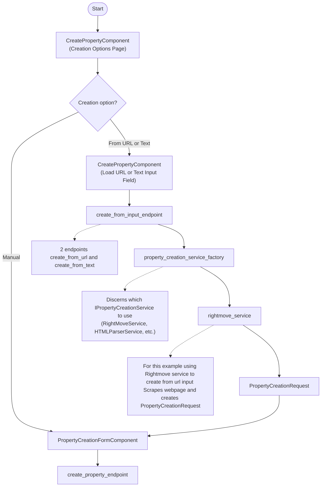

## Implementation Roadmap

### Phase 1: Core Backend Infrastructure
- [ ] Property model updates (ensure external_url field exists)
- [ ] PropertyCreationRequest schema (unsaved Property model structure)
- [ ] create_property_endpoint (manual creation, should already exist)
- [ ] Error handling patterns
- [ ] Validation layer

### Phase 2: Service Layer
- [ ] IPropertyCreationService interface
- [ ] property_creation_service_factory
- [ ] RightmoveService implementation
  - [ ] URL scraping logic
  - [ ] Data extraction to PropertyCreationRequest
- [ ] HTMLParserService (future)
- [ ] Service selection logic in factory

### Phase 3: Input Endpoints
- [ ] create_from_input_endpoint (single endpoint with parameter)
  - [ ] URL input handling
  - [ ] Text input handling
- [ ] Service factory integration
- [ ] Response structure (unsaved Property model)

### Phase 4: Frontend Components
- [ ] CreatePropertyComponent (creation options page)
- [ ] PropertyCreationFormComponent
- [ ] URL/Text input field UI
- [ ] Form population from PropertyCreationRequest
- [ ] Submit flow

### Phase 5: Integration & Testing
- [ ] End-to-end flow testing
- [ ] Error handling paths
- [ ] Auth/authorization integration
- [ ] Unit tests for services
- [ ] API endpoint tests
