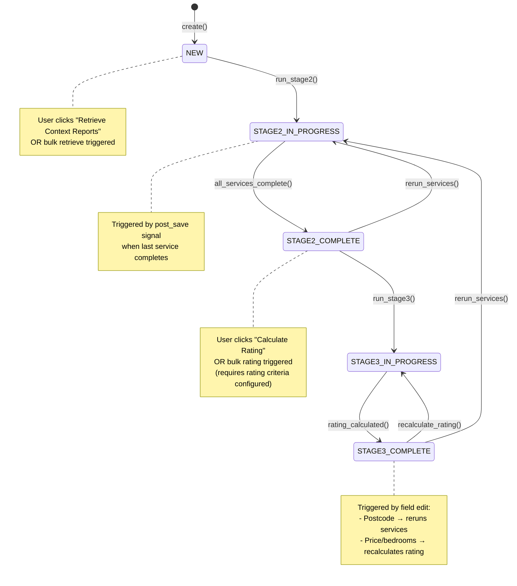
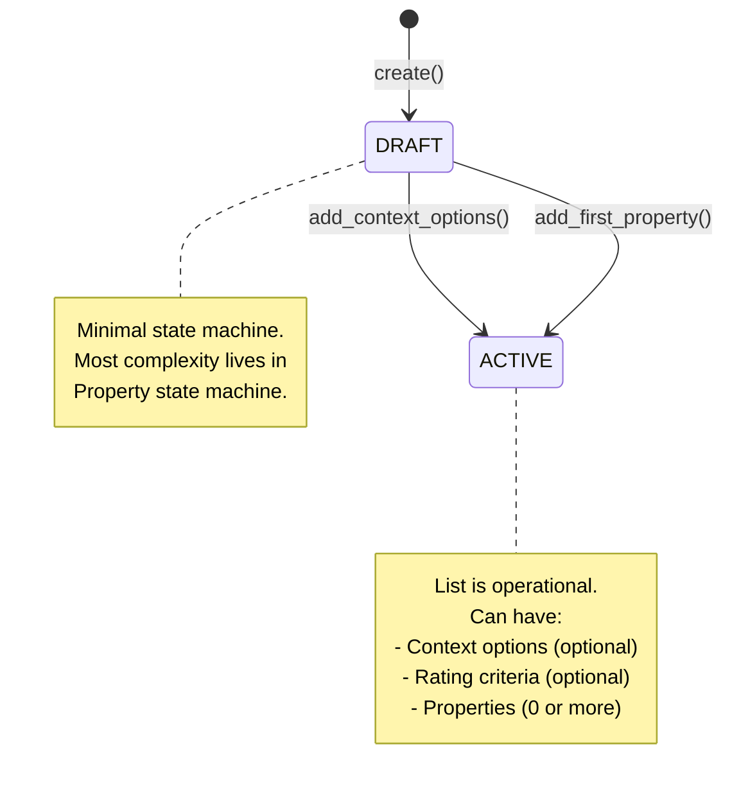
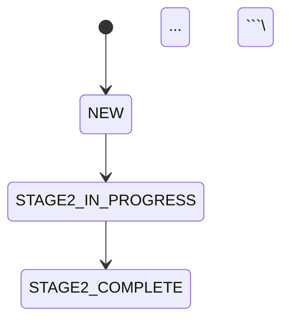
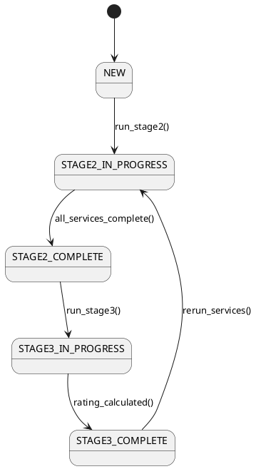

# State Machine Diagrams - Homely Project
**Date:** 2026-01-06
**Based on:** Architecture Decisions 2026-01-06

This document provides formal state machine definitions for PropertyList and Property entities, including Mermaid diagrams for visualization.

---

## Property State Machine

### States

| State                  | Description                                                              | UI Indicator                           | Next Actions Available                                                            |
| ---------------------- | ------------------------------------------------------------------------ | -------------------------------------- | --------------------------------------------------------------------------------- |
| **NEW**                | Initial state after property creation. No context data retrieved.        | "New" badge                            | • Retrieve Context Reports<br>• Edit details<br>• Delete                          |
| **STAGE2_IN_PROGRESS** | Context services are running (at least one service pending/in-progress). | "Retrieving reports..." + progress bar | • View progress<br>• Cancel (future feature)<br>• Edit non-dependent fields       |
| **STAGE2_COMPLETE**    | All context services have completed (success or failure).                | "Reports ready" or "X/Y reports ready" | • View reports<br>• Retry failed services<br>• Calculate rating<br>• Edit details |
| **STAGE3_IN_PROGRESS** | Rating calculation is running.                                           | "Calculating rating..."                | • View progress                                                                   |
| **STAGE3_COMPLETE**    | Rating has been calculated.                                              | Rating score badge (e.g., "87.5")      | • View rating breakdown<br>• Recalculate rating<br>• Edit details                 |

### Transitions



### Transition Details

#### 1. `create() → NEW`
**Trigger:** Property created via API (manual form, URL extraction, or text extraction)
**Preconditions:**
- Property List exists
- User has permission to add properties to list

**Actions:**
- Create Property record with state = NEW
- No ContextData records yet
- No rating data

**Frontend:**
- Redirect to property detail page
- Show "Retrieve Context Reports" button

---

#### 2. `run_stage2(): NEW → STAGE2_IN_PROGRESS`
**Trigger:**
- User clicks "Retrieve Context Reports" button (individual)
- User clicks "Retrieve Reports for All New Properties" (bulk)

**Preconditions:**
- Property state = NEW
- Property List has context options configured (if not, redirect to config form)

**Actions:**
```python
@transition(field=state, source='NEW', target='STAGE2_IN_PROGRESS')
def run_stage2(self):
    enabled_services = self.property_list.context_options.get_enabled_services()

    for service_name in enabled_services:
        ContextData.objects.create(
            property=self,
            service_name=service_name,
            status='PENDING'
        )
        run_service_task.delay(self.id, service_name)  # Celery task
```

**Frontend:**
- Establish WebSocket connection to `property_{id}` channel
- Display progress indicator: "Retrieving reports... 0/5 complete"
- Show individual service status (Pending → In Progress → Complete/Failed)

---

#### 3. `all_services_complete(): STAGE2_IN_PROGRESS → STAGE2_COMPLETE`
**Trigger:** Post-save signal on ContextData when last service completes/fails

**Preconditions:**
- All enabled services have status = COMPLETE or FAILED
- Property state = STAGE2_IN_PROGRESS

**Actions:**
```python
# Triggered automatically by signal handler
@receiver(post_save, sender=ContextData)
def context_data_updated(sender, instance, **kwargs):
    if instance.status in ['COMPLETE', 'FAILED']:
        property = instance.property

        if property.check_all_services_complete() and property.state == 'STAGE2_IN_PROGRESS':
            property.complete_stage2()  # FSM transition
```

**Frontend (via WebSocket):**
- Update progress bar to 100%
- Show completion notification: "All reports ready" or "4/5 reports successful"
- Enable "Calculate Rating" button (if criteria configured)
- Show retry buttons for failed services

---

#### 4. `run_stage3(): STAGE2_COMPLETE → STAGE3_IN_PROGRESS`
**Trigger:**
- User clicks "Calculate Rating" button (individual)
- User clicks "Calculate Ratings for All Eligible Properties" (bulk)

**Preconditions:**
- Property state = STAGE2_COMPLETE
- Property List has rating criteria configured

**Actions:**
```python
@transition(field=state, source=['STAGE2_COMPLETE', 'STAGE3_COMPLETE'], target='STAGE3_IN_PROGRESS')
def run_stage3(self):
    calculate_rating_task.delay(self.id)  # Celery task
```

**Frontend:**
- Show "Calculating rating..." spinner
- Disable edit fields temporarily (optional)

---

#### 5. `rating_calculated(): STAGE3_IN_PROGRESS → STAGE3_COMPLETE`
**Trigger:** Celery rating task completes successfully

**Preconditions:**
- Property state = STAGE3_IN_PROGRESS
- Rating calculation completed

**Actions:**
```python
# In Celery task
@shared_task
def calculate_rating_task(property_id):
    property = Property.objects.get(pk=property_id)

    # Calculate rating (details in architecture_decisions doc)
    rating_result = property.calculate_rating()

    # Store result
    property.overall_rating = rating_result['overall_score']
    property.rating_breakdown = rating_result['criterion_scores']

    # Transition state
    property.complete_stage3()
    property.save()

    # Send WebSocket update
    send_websocket_message(...)
```

**Frontend (via WebSocket):**
- Display rating badge: "87.5"
- Show "View Rating Breakdown" link
- Update property card with rating color coding

---

#### 6. `rerun_services(): [STAGE2_COMPLETE | STAGE3_*] → STAGE2_IN_PROGRESS`
**Trigger:**
- User edits field with service dependencies (e.g., postcode) + confirms rerun
- User clicks "Retry" on failed service
- User adds context options to list (automatic bulk rerun)

**Preconditions:**
- Property state = STAGE2_COMPLETE, STAGE3_IN_PROGRESS, or STAGE3_COMPLETE
- At least one service needs to be rerun

**Actions:**
```python
@transition(field=state, source=['STAGE2_COMPLETE', 'STAGE3_IN_PROGRESS', 'STAGE3_COMPLETE'], target='STAGE2_IN_PROGRESS')
def rerun_services(self, service_names):
    for service_name in service_names:
        # Update or create ContextData
        ContextData.objects.update_or_create(
            property=self,
            service_name=service_name,
            defaults={'status': 'PENDING', 'error_message': None}
        )
        run_service_task.delay(self.id, service_name)
```

**Use Cases:**

**a) Field Edit (Postcode Change)**
```python
# In property update API view
if 'postcode' in changed_fields:
    affected_services = ['crime', 'schools', 'poi', 'broadband', 'mobile']
    property.rerun_services(affected_services)
```

**b) Manual Retry of Failed Service**
```python
# User clicks "Retry" on Crime report
property.rerun_services(['crime'])
```

**c) Bulk Rerun After Context Options Added**
```python
# User adds "Broadband" to context options
for property in properties:
    if property.state != 'NEW':
        property.rerun_services(['broadband'])
```

**Frontend:**
- Show confirmation dialog (if triggered by field edit)
- Return to "Retrieving reports..." state
- Update progress indicator

---

#### 7. `recalculate_rating(): STAGE3_COMPLETE → STAGE3_IN_PROGRESS`
**Trigger:**
- User edits field with rating dependencies (e.g., price, bedrooms)
- User edits rating criteria for the list (copy-on-write triggered)
- Context data updated (service rerun completed)

**Preconditions:**
- Property state = STAGE3_COMPLETE
- Property List has rating criteria configured

**Actions:**
```python
# Triggered automatically after field update or service completion
if property.state == 'STAGE3_COMPLETE' and property.needs_rating_recalculation(changed_fields):
    property.recalculate_rating()  # Triggers run_stage3 transition
```

**Frontend:**
- Brief "Recalculating..." indicator
- Updated rating displayed when complete

---

### Edge Cases and Error Handling

#### What if user clicks "Retrieve Reports" while in STAGE2_IN_PROGRESS?
**Behavior:** Button is disabled while in progress.
**UI:** "Retrieving reports... 3/5 complete" (not clickable)

#### What if user clicks "Calculate Rating" while in STAGE3_IN_PROGRESS?
**Behavior:** Button is disabled while in progress.
**UI:** "Calculating rating..." (not clickable)

#### What if all services FAIL?
**Behavior:** Property still transitions to STAGE2_COMPLETE (partial success policy).
**UI:** "0/5 reports successful. Retry all failed services?"

#### What if rating calculation fails (error in task)?
**Behavior:** Property remains at STAGE3_IN_PROGRESS, error logged.
**UI:** "Rating calculation failed. Please try again."
**Recovery:** User can click "Calculate Rating" again (retry).

---

## PropertyList State Machine

### States

| State | Description | UI Indicator | Actions Available |
|-------|-------------|--------------|-------------------|
| **DRAFT** | Initial state. List created but empty (no context options, no properties). | Hidden (internal state only) | • Add context options<br>• Add properties<br>• Delete list |
| **ACTIVE** | List has context options and/or properties. Operational. | None (normal state) | • Add/edit properties<br>• Edit context options<br>• Edit rating criteria<br>• Delete list |

### Transitions



### Transition Details

#### 1. `create() → DRAFT`
**Trigger:** User creates new Property List

**Actions:**
- Create PropertyList with title, owner
- State = DRAFT
- context_options = null
- rating_criteria = null

**Frontend:**
- Redirect to Property List detail page
- Show "Add Context Options" and "Add Property" buttons

---

#### 2. `add_context_options(): DRAFT → ACTIVE`
**Trigger:** User saves context options for the first time

**Actions:**
```python
@transition(field=state, source='DRAFT', target='ACTIVE')
def add_context_options(self, options):
    ContextOptions.objects.create(
        property_list=self,
        **options
    )
```

**Frontend:**
- List detail page now shows "Context Options: Configured ✓"

---

#### 3. `add_first_property(): DRAFT → ACTIVE`
**Trigger:** User adds first property to list

**Actions:**
```python
@transition(field=state, source='DRAFT', target='ACTIVE')
def add_first_property(self):
    # Transition happens automatically when first property created
    pass
```

**Frontend:**
- List detail page now shows property in list

---

### Notes

**Why is PropertyList state machine so simple?**
- PropertyList is primarily a container
- Its "status" is derived from child properties (e.g., "3 properties rated, 2 pending")
- Most state complexity belongs to individual Property entities

**Derived Status Display:**
Instead of complex PropertyList states, the UI derives status from properties:

```python
# In PropertyList model
def get_status_summary(self):
    properties = self.property_set.all()

    return {
        'total': properties.count(),
        'new': properties.filter(state='NEW').count(),
        'stage2_in_progress': properties.filter(state='STAGE2_IN_PROGRESS').count(),
        'stage2_complete': properties.filter(state='STAGE2_COMPLETE').count(),
        'stage3_in_progress': properties.filter(state='STAGE3_IN_PROGRESS').count(),
        'stage3_complete': properties.filter(state='STAGE3_COMPLETE').count(),
    }
```

**UI Display:**
```
Property List: My House Hunt

Status:
✓ 5 properties fully rated
⟳ 2 properties retrieving reports
! 3 properties need reports

Context Options: Configured ✓
Rating Criteria: Configured ✓
```

---

## State Persistence

### Database Schema

```sql
-- Property table
CREATE TABLE property (
    id SERIAL PRIMARY KEY,
    property_list_id INTEGER REFERENCES property_list(id),
    state VARCHAR(30) NOT NULL DEFAULT 'NEW',

    -- Stage 1 fields
    title VARCHAR(255),
    postcode VARCHAR(10),
    price DECIMAL(10, 2),
    bedrooms INTEGER,
    -- ... other property fields

    -- Stage 3 fields
    overall_rating DECIMAL(5, 2) NULL,
    rating_breakdown JSONB NULL,

    -- Timestamps
    created_at TIMESTAMP DEFAULT NOW(),
    updated_at TIMESTAMP DEFAULT NOW(),

    -- State machine constraints
    CONSTRAINT valid_state CHECK (
        state IN ('NEW', 'STAGE2_IN_PROGRESS', 'STAGE2_COMPLETE', 'STAGE3_IN_PROGRESS', 'STAGE3_COMPLETE')
    )
);

-- PropertyList table
CREATE TABLE property_list (
    id SERIAL PRIMARY KEY,
    owner_id INTEGER REFERENCES auth_user(id),
    title VARCHAR(255) NOT NULL,
    state VARCHAR(30) NOT NULL DEFAULT 'DRAFT',
    context_options_id INTEGER REFERENCES context_options(id) NULL,
    rating_criteria_id INTEGER REFERENCES rating_criteria(id) NULL,

    created_at TIMESTAMP DEFAULT NOW(),
    updated_at TIMESTAMP DEFAULT NOW(),

    CONSTRAINT valid_state CHECK (
        state IN ('DRAFT', 'ACTIVE')
    )
);

-- ContextData table (tracks service execution state)
CREATE TABLE context_data (
    id SERIAL PRIMARY KEY,
    property_id INTEGER REFERENCES property(id),
    service_name VARCHAR(50) NOT NULL,
    status VARCHAR(30) NOT NULL DEFAULT 'PENDING',
    data JSONB NULL,
    error_message TEXT NULL,

    created_at TIMESTAMP DEFAULT NOW(),
    updated_at TIMESTAMP DEFAULT NOW(),

    UNIQUE(property_id, service_name),

    CONSTRAINT valid_status CHECK (
        status IN ('PENDING', 'IN_PROGRESS', 'COMPLETE', 'FAILED')
    )
);
```

---

## State Transition Logs (Audit Trail)

For debugging and analytics, log all state transitions:

```python
# Model
class StateTransitionLog(models.Model):
    # Generic FK to Property or PropertyList
    content_type = models.ForeignKey(ContentType)
    object_id = models.PositiveIntegerField()
    content_object = GenericForeignKey('content_type', 'object_id')

    from_state = models.CharField(max_length=30)
    to_state = models.CharField(max_length=30)
    transition_name = models.CharField(max_length=50)

    triggered_by = models.ForeignKey(User, null=True)  # User who triggered (if manual)
    triggered_by_system = models.BooleanField(default=False)  # Automatic transition

    timestamp = models.DateTimeField(auto_now_add=True)

    metadata = models.JSONField(default=dict)  # Additional context

# Signal handler to auto-log
from django_fsm.signals import post_transition

@receiver(post_transition)
def log_state_transition(sender, instance, name, source, target, **kwargs):
    StateTransitionLog.objects.create(
        content_object=instance,
        from_state=source,
        to_state=target,
        transition_name=name,
        triggered_by=getattr(instance, '_transition_user', None),
        triggered_by_system=(getattr(instance, '_transition_user', None) is None),
        metadata={
            'model': sender.__name__,
            'instance_id': instance.id
        }
    )
```

**Usage:**
```python
# Viewing transition history for a property
transitions = StateTransitionLog.objects.filter(
    content_type=ContentType.objects.get_for_model(Property),
    object_id=property.id
).order_by('-timestamp')

# Output:
# 2026-01-06 14:30 | NEW → STAGE2_IN_PROGRESS | run_stage2 | User: john@example.com
# 2026-01-06 14:35 | STAGE2_IN_PROGRESS → STAGE2_COMPLETE | all_services_complete | System
# 2026-01-06 14:36 | STAGE2_COMPLETE → STAGE3_IN_PROGRESS | run_stage3 | User: john@example.com
# 2026-01-06 14:36 | STAGE3_IN_PROGRESS → STAGE3_COMPLETE | rating_calculated | System
```

---

## State Machine Testing

### Unit Tests

```python
from django.test import TestCase
from django_fsm import TransitionNotAllowed

class PropertyStateMachineTestCase(TestCase):
    def setUp(self):
        self.property = Property.objects.create(
            title="Test Property",
            state='NEW'
        )

    def test_valid_transition_new_to_stage2(self):
        """Test normal flow: NEW → STAGE2_IN_PROGRESS"""
        self.property.run_stage2()
        self.property.save()
        self.assertEqual(self.property.state, 'STAGE2_IN_PROGRESS')

    def test_invalid_transition_new_to_stage3(self):
        """Test that skipping Stage 2 is not allowed"""
        with self.assertRaises(TransitionNotAllowed):
            self.property.run_stage3()

    def test_rerun_from_stage3_complete(self):
        """Test service rerun from STAGE3_COMPLETE → STAGE2_IN_PROGRESS"""
        # Setup: advance property to STAGE3_COMPLETE
        self.property.state = 'STAGE3_COMPLETE'
        self.property.save()

        # Trigger rerun
        self.property.rerun_services(['crime'])
        self.property.save()

        self.assertEqual(self.property.state, 'STAGE2_IN_PROGRESS')

    def test_all_services_complete_with_failures(self):
        """Test partial success: some services failed but property completes"""
        self.property.state = 'STAGE2_IN_PROGRESS'
        self.property.save()

        # Create service results
        ContextData.objects.create(property=self.property, service_name='crime', status='COMPLETE')
        ContextData.objects.create(property=self.property, service_name='schools', status='FAILED')
        ContextData.objects.create(property=self.property, service_name='poi', status='COMPLETE')

        # Simulate last service completing
        # (In real code, post_save signal would trigger transition)
        self.property.complete_stage2()
        self.property.save()

        self.assertEqual(self.property.state, 'STAGE2_COMPLETE')
```

### Integration Tests

```python
class PropertyWorkflowIntegrationTestCase(TestCase):
    def test_full_property_lifecycle(self):
        """Test complete workflow: creation → Stage 2 → Stage 3"""

        # 1. Create property
        property = Property.objects.create(
            title="Test Property",
            postcode="SW1A 1AA",
            state='NEW'
        )
        self.assertEqual(property.state, 'NEW')

        # 2. Trigger Stage 2
        property.run_stage2()
        property.save()
        self.assertEqual(property.state, 'STAGE2_IN_PROGRESS')

        # 3. Simulate services completing
        for service in ['crime', 'schools']:
            ContextData.objects.create(
                property=property,
                service_name=service,
                status='COMPLETE',
                data={'sample': 'data'}
            )

        # Signal handler would transition automatically
        property.complete_stage2()
        property.save()
        self.assertEqual(property.state, 'STAGE2_COMPLETE')

        # 4. Trigger Stage 3
        property.run_stage3()
        property.save()
        self.assertEqual(property.state, 'STAGE3_IN_PROGRESS')

        # 5. Simulate rating calculation
        property.overall_rating = 85.0
        property.complete_stage3()
        property.save()
        self.assertEqual(property.state, 'STAGE3_COMPLETE')
        self.assertEqual(property.overall_rating, 85.0)
```

---

## Diagram Export Formats

These state machines can be visualized using:

### Mermaid (Markdown)
```markdown


### Draw.io
1. Copy the state names and transitions
2. Use draw.io's built-in state diagram shapes
3. Follow UML state machine conventions:
   - Rounded rectangles for states
   - Arrows for transitions
   - Initial state: solid black circle
   - Labels on arrows: `event / action`

### PlantUML


---

## Summary

**Property State Machine:**
- 5 states: NEW, STAGE2_IN_PROGRESS, STAGE2_COMPLETE, STAGE3_IN_PROGRESS, STAGE3_COMPLETE
- 7 transitions: create, run_stage2, all_services_complete, run_stage3, rating_calculated, rerun_services, recalculate_rating
- Implements django-fsm for enforcement
- Logged via post_transition signals

**PropertyList State Machine:**
- 2 states: DRAFT, ACTIVE
- 3 transitions: create, add_context_options, add_first_property
- Minimal complexity (container model)
- Derived status from child properties

Both state machines are now formally defined and ready for implementation alongside the workflow diagrams.
